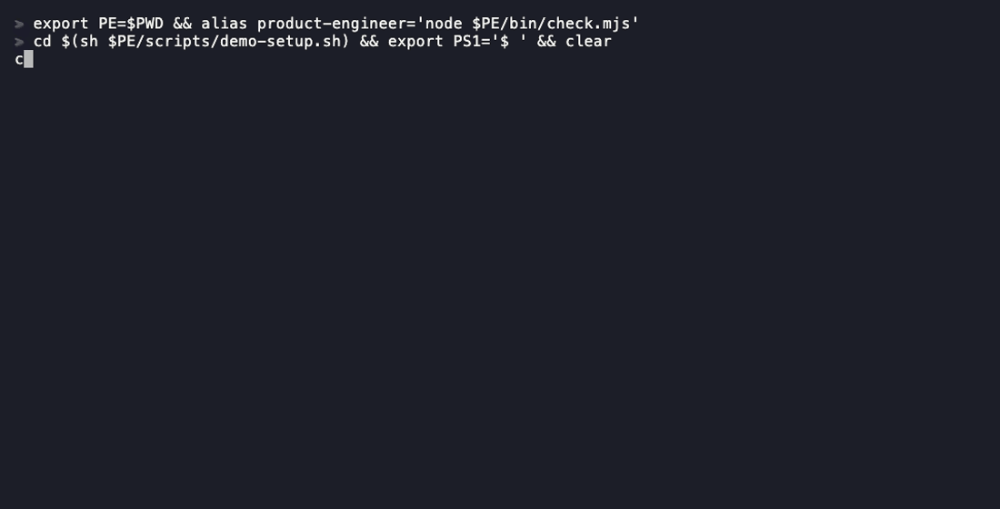

# My coding agent's commit message says it added tests, and the change has none.

product-engineer is an agent skill and command-line checker: the skill asks AI coding agents to explain each commit and pull request in plain language, and the checker warns when a message contradicts the diff.

That is two parts that work separately: a checker that compares a message with the change it describes, and a skill that gets the agent to write the plain-language note. [Below](#two-parts-used-separately) says which evidence belongs to which.

**Start here.** Nothing to install, no model, no account, works on a message written by an agent or by a person:

```
npx product-engineer check msg.txt --diff
```

`msg.txt` holds the commit message and the change is what you staged with `git add`. Run it inside a git repository. For a pull request: `npx product-engineer check --pr 12 --diff main...HEAD` (needs `gh`).



The recording is real output, made with [vhs](https://github.com/charmbracelet/vhs) from [`docs/demo-diff.tape`](docs/demo-diff.tape). `--diff` prints warnings and exits 0, so it never blocks a commit by itself; `--strict` makes the mismatches the change proves exit 1. It splits what it finds in two: what it verified against the change, and what the author claims that no diff can show (that tests ran, that it was tried by hand). What it can and cannot decide is [listed below](#does-the-message-match-the-change); "added" against "removed" goes unnoticed unless the message names a file, a backticked name or one of six security words.

English | [Türkçe](README.tr.md) | [简体中文](README.zh-CN.md)

<p>
  <a href="https://www.npmjs.com/package/product-engineer"></a>
  <a href="https://www.npmjs.com/package/product-engineer"></a>
  
  
  
  <a href="https://github.com/Bubblegunn/product-engineer/actions/workflows/lint.yml"></a>
  <a href="https://github.com/Bubblegunn/product-engineer/actions/workflows/test.yml"></a>
  
  <a href="https://github.com/marketplace/actions/product-engineer-check"></a>
</p>

## Two parts, used separately

| | 1. The diff check | 2. The agent skill |
|---|---|---|
| What it does | Reads a message and the change, warns when the message says something the change contradicts | Tells an agent to restate the work as a customer outcome and end each commit with a "For the customer" block |
| Needs | Node 22 or newer, a git repository | An agent that loads skills, and a model that follows them |
| Deterministic | Yes. No model call, same input gives the same output | No. The result depends on the model |
| Evidence | 0 false alarms on 59 of this repository's own commits ([`evals/baseline/RESULTS.md`](evals/baseline/RESULTS.md)); a run over thousands of public commits is in [`docs/check-reference.md`](docs/check-reference.md#false-alarms-on-public-commits) | The table below: the block appears on Opus 8 of 8, Sonnet 13 of 24, Haiku 0 of 24. Nothing here shows that the explanations are more accurate or easier to understand |

Take the check first. Add the skill if you want the agent to write the plain-language block; add the hook or the Action once you trust the check on your own history. Which of the other routes were actually run is in [`docs/install.md`](docs/install.md#what-has-been-run).

## Does the skill part work?

It depends on the model. The skill is four skills, each a SKILL.md with the main one also carrying reference files, that tell an agent to write a plain-language "For the customer" block in each commit, say what it observed, and name what it did not build. It was run on the same eight small tasks, bare and with the skill, on three models. The row below is the commit carrying the block.

| model | without the skill | with the skill | reading |
|---|---|---|---|
| claude-opus-5 | 0 / 8 | 8 / 8 | not computed, one run per task |
| claude-sonnet-5-5 | 0 / 24 | 13 / 24 | worked |
| claude-haiku-4-5 | 0 / 24 | 0 / 24 | no clear effect |

On claude-haiku-4-5 all five measures read "no clear effect". Why is partly visible in the cost data ([`evals/WEAK-MODELS.md`](evals/WEAK-MODELS.md)): the runs that wrote the block are the ones that spent extra turns and tokens, and the Haiku skill runs spent none, which fits a skill that never loaded; the transcripts do not record it, so it is not proven. The reading rule was written before any data existed ([`evals/MODELS-DESIGN.md`](evals/MODELS-DESIGN.md)). The checks are regular expressions over the agent's own words, so they reward saying the right thing ([`evals/RESULTS.md`](evals/RESULTS.md) lists what they miss). The skill also costs more on the largest model: $0.45 per run bare and $0.63 with the skill on claude-opus-5. Every number, cost and transcript: [`evals/RESULTS-models.md`](evals/RESULTS-models.md).

### What the skill's effect is, per model

Measured on these eight tasks, each number is the count of runs that passed a regular-expression check on the agent's own words ([`evals/RESULTS-models.md`](evals/RESULTS-models.md)):

- **claude-opus-5**, one run per task, no interval computed: the commit carries the block 0 of 8 bare, 8 of 8 with the skill; reports what it observed or could not check 1 of 8, 7 of 8; names something deliberately not done 2 of 8, 5 of 8; a method or scope next to every number 0 of 8, 2 of 8. A run cost $0.45 bare and $0.63 with the skill.
- **claude-sonnet-5-5**, three runs per task: the block 0 of 24, 13 of 24 (interval +0.25 to +0.83 per task, "worked"). The other four measures show no clear effect. A run cost $0.09 bare and $0.10 with the skill.
- **claude-haiku-4-5**, three runs per task: no clear effect on any of the five measures; the block appeared 0 of 24 with and without the skill.

Not measured: whether the block is more accurate or easier to read than what the model writes without the skill, and whether the agent's work is better. A larger comparison was made on a development branch, with an extended, unreleased version of the skill against the bare model and other skills, on tasks written by people who had not seen it. It showed no reliable lead over the bare model: one development round was ahead, but on the sealed final set and on the two other rounds the interval for the difference included zero, and the extended version cost about 1.4 to 1.5 times the bare model's price per session. Those result files are not in this repository's main history, so no number from them is quoted here. This README therefore does not say that installing the skill makes an agent's work better than the bare model's; it says the block appears on some models and not on others.

## How this differs

The checker comparison was rerun on 2026-11-02 on this branch (version 0.8.0 plus later commits; the first run, 2026-10-21 on 0.7.0, is kept in `evals/comparison/`) and gave the same outcome on all 12 messages. The skill comparison was not rerun: it needs a model and still stands at its 2026-10-20 run (skill 0.6.2). The generated tables, the pinned competitor versions and the commands to repeat them are in [`docs/COMPARISON.md`](docs/COMPARISON.md). Rows where product-engineer loses are in that file. The tables here show only rows it wins or ties.

**Against commitlint 21.2.4**, which checks the Conventional Commits shape, which product-engineer does not. They run together: product-engineer ships a commitlint plugin (`product-engineer/commitlint`). Same message text given to both:

| message | product-engineer | commitlint |
|---|---|---|
| A full customer block | passed | passed |
| No customer block | flagged | passed |
| Passing tests offered as the evidence | flagged | passed |
| A number with no method or scope | flagged | passed |
| Says tests were added; the change has none | flagged | cannot |

"cannot" means commitlint is never shown the change. Page: [`docs/vs-commitlint.md`](docs/vs-commitlint.md).

**Against two other agent skills**, on the eight tasks, claude-opus-5, one run per task (commits in the first row: how many of eight carried the block). The measures were written for product-engineer's own rules, so a skill that aims elsewhere scores low on them by design. [`verification-before-completion`](docs/vs-verification-before-completion.md) is from obra/superpowers (MIT); [`changelog-generator`](docs/vs-changelog-generator.md) is from ComposioHQ/awesome-claude-skills (no licence detected, run only):

| measure | product-engineer | verification-before-completion | changelog-generator |
|---|---|---|---|
| Commit carries the For-the-customer block | 8 / 8 | 0 / 8 | 0 / 8 |
| Final message reports an observation or says what it could not check | 7 / 8 | 0 / 8 | 0 / 8 |
| Final message names something deliberately not done | 5 / 8 | 0 / 8 | 1 / 8 |
| Every number in the final message has a method or scope next to it | 2 / 8 | 1 / 8 | 2 / 8 |
| Only the requested files changed (tests and documentation allowed) | 8 / 8 | 7 / 8 | 7 / 8 |

The headline feature of `changelog-generator`, writing a changelog from commits, was not measured. None of the eight tasks asks for one.

## See it

The same commit, before:

```
fix(notifications): classify IsSystem events as idempotent and skip the badge increment
```

After:

```
fix(notifications): classify IsSystem events as idempotent and skip the badge increment

For the customer:
What changed: Things the system handles on its own no longer light up the phone or the menu badge; only items that need a person do.
Why it matters: The badge count means "something needs you" again, so people stop ignoring it.
Automation effect: Automatic housekeeping events are now fully handled without anyone looking at them.
```

The agent's report, before:

```
Done. All 42 tests pass.
```

After:

```
Watched it in staging logs: 3 of 3 webhook retries logged, final failure recorded with the booking id.
Could not check: production, no deploy yet.
Not shipped:
- Dead-letter queue: three retries cover every failure in 90 days of logs.
```

The check, on a message without the block and then with it (the two fixtures are in
[`test/fixtures/`](test/fixtures/), so the picture can be reproduced from the command):


A longer pair, unedited, from the evaluation: [`docs/examples.md`](docs/examples.md). The mismatches the check reports, what it only lists, and two cases where it passes something wrong, each with the real output: [`docs/proof.md`](docs/proof.md).

Every pair from the committed eval runs, including the ones where the skill changed nothing or made the message
worse, is on [the gallery page](https://bubblegunn.github.io/product-engineer/gallery.html), generated from the
transcripts (contributed by [@Nitjsefnie](https://github.com/Nitjsefnie) in
[#47](https://github.com/Bubblegunn/product-engineer/pull/47)).

One real defect in a public repository, fixed twice by the same model on the same commit,
with the skill and without, both commit messages quoted whole:
[`docs/case-study.md`](docs/case-study.md).

## Add the agent skill, the hook or the Action

The skill is the second part ([above](#two-parts-used-separately)).

```
npx skills add Bubblegunn/product-engineer
```

In Claude Code you can install it as a plugin instead (Claude Code 2.1.275 or later):

```
/plugin install product-engineer --marketplace Bubblegunn/product-engineer
```

`npx skills add` places the skill files for the agents it finds in your project. That is a statement about
where files go. Only Claude Code has been run with the skill loaded; for Codex, Cursor, Copilot, Gemini CLI and the rest
the files are placed and nothing more has been verified. [`docs/install.md`](docs/install.md#what-has-been-run) lists, route by
route, what was run and what was not, and where each file lands. Cursor as a rule file
rather than a skill is in [`docs/cursor.md`](docs/cursor.md).

The skills are text files and need nothing installed. The `product-engineer` command (`check`,
`doctor`, the pre-commit entry) needs Node 22 or newer; the commit-msg hook itself is POSIX sh.

For npm users, install the generated commit hook with `npx product-engineer hook install`; add `--prefill` to also install the `prepare-commit-msg` template (the `hook` command was contributed by
[@Aaqibhafeezkhan](https://github.com/Aaqibhafeezkhan) in [#44](https://github.com/Bubblegunn/product-engineer/pull/44)).

## What the diff check costs

`--diff` fires only when it can prove a mismatch, so the question that matters is how often
it is wrong about a message somebody actually wrote. `npm run baseline` answers it on the
history of whatever repository you run it in: it mutates real commits so each message
contradicts its own diff, asks whether the checker notices, and writes
[`evals/baseline/RESULTS.md`](evals/baseline/RESULTS.md). CI reruns it on every push and fails
on a false alarm, on a reachable kind going uncaught, or on the unreachable kind being caught.

Run on this repository at `25dcce7`: 64 non-merge commits with file changes, 59 of them scored:

| measure | value |
|---|---:|
| false alarms on real messages | 0 |
| specificity | 100% |
| recall, the four kinds any check can reach | 100% |
| recall, `operation` | 0% |

The counts move as the history grows, which is why the run is named. Rerun it and you get
your own numbers, on your own repository.

That last row is in the corpus on purpose. No check reads operation verbs, so swapping
`added` for `removed` goes unnoticed, and a blind spot printed as a zero is one you can see.
Three kinds in the taxonomy this borrows from cannot be produced mechanically at all, because
they need someone to read what the code means; this reads a numstat.

Running it found three false alarms on real commits and all three are fixed, which is the
outcome the harness is for. It sits beside published numbers for models asked the same
question, and the design document explains why that is context rather than a comparison.

## The pack

| skill | what it is | install it when |
|---|---|---|
| [`product-engineer`](skills/product-engineer/SKILL.md) | the seven rules and the reference files | your agent writes code |
| [`customer-block`](skills/customer-block/SKILL.md) | rule 2 alone: the block, with two pairs | you only want the block in commits and pull requests |
| [`done-means-observed`](skills/done-means-observed/SKILL.md) | rule 3 alone: what was watched, what could not be checked | you only want honest completion reports |
| [`release-notes`](skills/release-notes/SKILL.md) | the rules for an agent that writes about software instead of writing it | release notes, changelogs, status updates |

The installer offers all four; pick what you need. Agents that read instruction files
rather than skills (Cursor rules, Copilot instructions, Gemini, Cline, Kiro, Windsurf) get
the same seven rules from files generated out of `SKILL.md`; see
[`docs/install.md`](docs/install.md).

## The seven rules

1. Restate before building. One sentence of customer outcome, or one question.
2. For the customer, every time. What changed, why it matters, automation effect only if real.
3. Done means observed. Logs, data or a real device, or say what you could not check.
4. Build what was asked; name what you did not. A `Not shipped:` list with reasons.
5. No number without a count. Every figure has a command behind it and a scope.
6. Speak the stakeholder's language. A jargon-to-plain table ships with the skill.
7. Smallest change that moves the metric. One ledger line before any design.

Full text: [`skills/product-engineer/SKILL.md`](skills/product-engineer/SKILL.md). The
template, the five questions, the done checklist, the plain-language table and the
not-shipped format are in [`references/`](skills/product-engineer/references/).

## Check a message or a pull request

`product-engineer check` reads a commit message or PR description and reports whether it
carries the block and whether the block reads the way the skill asks: `What changed`, `Why it
matters`, an `Automation effect` line that is either meaningful or absent, a well-formed
`Not shipped:` list, numbers without a method next to them, and jargon from the plain-language
table used without an explanation.

```
node bin/check.mjs check .git/COMMIT_EDITMSG     # or: product-engineer check <file|->
node bin/check.mjs check --pr 12                 # the body through the GitHub API, or gh outside Actions
node bin/check.mjs check --pr 12 --comment       # and one comment on the pull request, updated in place
node bin/check.mjs template                      # print an empty block to fill in (supports --lang)
```

To configure git to use the block as your commit template (the `template` command was contributed by
[@Enard52](https://github.com/Enard52) in [#41](https://github.com/Bubblegunn/product-engineer/pull/41)):

```sh
product-engineer template > .gitmessage.txt
git config commit.template .gitmessage.txt
```


### Generate customer notes

Use `product-engineer notes` to turn customer blocks from a Git revision range into Markdown for a release note. The range follows Git's revision syntax; commits without a customer block are counted rather than silently omitted. (The `notes` command was contributed by [@Aaqibhafeezkhan](https://github.com/Aaqibhafeezkhan) in [#46](https://github.com/Bubblegunn/product-engineer/pull/46).)

```sh
npx product-engineer notes v0.7.0..HEAD
```

For example, the output looks like this:

```markdown
# Customer notes

- Customers can download monthly bookings.
  - Why it matters: They no longer copy each row by hand.

1 commit without a block
```

The command honours the headings configured in `.product-engineer.json`. An invalid range, a missing range, or a range beginning with a flag exits with code 2.

### Does the message match the change?

Everything above reads the message alone, so it can tell whether you said the right shapes.
It cannot tell whether what you said is true, and in 2026 that is the gap that hurts: the
description reads clean, the change is large, and the reviewer has no way to know which
sentences were checked. `--diff` reads the change itself and reports where the two disagree.

```
node bin/check.mjs check .git/COMMIT_EDITMSG --diff        # the staged change
node bin/check.mjs check --pr 12 --diff main...HEAD        # a branch
```

The result is split in two. **Verified from the change** are statements a diff can prove or disprove by itself:

| the message says | and the change shows | reported |
|---|---|---|
| tests were added | no test file gains a line (a Rust or Python test written inside a source file counts) | a warning, with the file counts |
| documentation only | a source or test file changed | a warning, naming the files |
| comments only | a changed line in a code file is not a comment | a warning |
| a file count | a different number of files | a warning, with both numbers |
| a path | it is in neither the change nor the repository | a warning, naming the path |
| a file was added or removed | the change does the opposite to that file | a warning |
| a name in backticks was added or removed | it appears only on the opposite side of the changed lines | a warning |
| authentication, permissions, CSRF, rate limiting, sanitization or encryption was added or removed | it appears only on the opposite side | a warning |
| a bug was fixed | every changed file is documentation (`.md`, `.rst`, `.adoc`) and the message names no documentation | a warning |
| no breaking changes | an exported name (JS/TS, Python, Go, Rust) is removed and defined nowhere in the added lines | a warning, to confirm it is not public API |

**Claimed by the author and not checkable** are listed at info level and never judged: that tests ran or pass, that it was tested or verified by hand, a speed or size figure. A diff contains no execution, so the check cannot tell a true "all tests pass" from an invented one; it lists the sentence so the reviewer knows it rests on trust. The message-level check still warns when a customer block offers a green suite as its evidence.

Where the change does not decide the question, the check says nothing: a name that appears on both sides (edited or moved), a name that is not in the change at all, a message that both adds and removes the same name (a squash of several steps), a statement about the future, a negation, and any message in a language other than English. These checks read English only. A Turkish, Japanese or Chinese message gets the block and readability checks and no claim checks; that is a miss, never a false alarm ([#15](https://github.com/Bubblegunn/product-engineer/issues/15)).

The path check is the one worth having. A path that exists but is untouched is ordinary context
and is never reported; a path that is in neither place is a reference to a file that was
renamed, or never existed, which is a shape agent-written messages leave behind. A URL is not a path, and a
pull request template's comments and unchecked checklist items are not claims.

A phrase inside backticks or quotation marks is being named, not asserted, so a message that
describes these checks does not trip them. That was the first thing the flag caught, on the
commit that added it.

Each check is conservative on purpose. A refactor claiming no behaviour change is not
checked against the source it touches, because that claim is usually true, and a number is
only read as a file count when its sentence also carries a verb of changing. By default
nothing here reports an error, so a run that passed yesterday cannot fail today; without
`--diff` the output is byte-identical to before. `--diff --strict` turns the findings a change
proves (tests claimed and none added, documentation only over code, comments only over code, a bug fix over
documentation, a file or name added when it was removed or the reverse) into errors, for a CI step that should fail on them. Counts, paths
and the heuristic findings stay warnings under `--strict`.

**Cited paths are checked too.** Every file path and GitHub Actions run URL the message cites is resolved against the working tree. A missing path or a line past the end of a file is a warning. The modes, and the reason a message that cites nothing still passes, are in [`docs/check-reference.md`](docs/check-reference.md#cited-paths).

Write the block in the language your team writes. English, Turkish, Japanese and Chinese
headings are accepted with no configuration, and a heading for any other language goes in
`.product-engineer.json`; the table and the format are in
[`skills/product-engineer/references/headings.md`](skills/product-engineer/references/headings.md),
and the commit-msg hook is generated from it so the two cannot disagree.

The block also gets a readability line (Flesch for English, Ateşman with `--lang tr`, and LIX), as information only. For scripts these formulas do not suit, the tool names the script, says it is not scoring and prints no number: [`docs/check-reference.md`](docs/check-reference.md#readability). Exit 1 on a missing block, 0 with `--warn`. `--format github` turns the findings into run annotations, and `--format json` prints them as one JSON object, `{ ok, findings: [{ level, code, message }], readability }`, for editors and dashboards. As a CI step
(needs `pull-requests: write` for the comment, see [`docs/install.md`](docs/install.md)):

```yaml
      - uses: Bubblegunn/product-engineer@v0
        # with: { warn: "true" }   # report instead of failing
```

## What it does not do

It runs no process and owns no workflow; it composes with spec, TDD and review skills. It
does not write product strategy. It enforces nothing unless you install the hook.

## Where it comes from

These are the rules Efe Genc worked by in four years in software engineering since
January 2022, as one of two founding engineers at Cendra, and as the sole author of a proactive
assistant: a commit convention
that explains every change to a non-technical reader, a definition of done that means
watching the thing behave, and the habit of writing down what was deliberately not built
([The feature I chose not to ship](https://efegenc.me/writing/the-feature-i-chose-not-to-ship/)).

## Contributing

Rule changes need one before/after pair and one eval task; see
[CONTRIBUTING.md](CONTRIBUTING.md), which also describes the one-command release. The [roadmap](ROADMAP.md) is short on purpose.
Translations and per-stack jargon tables are labelled `good first issue`.

## Contributors

Thank you to everyone who has sent a change that landed here:

- [@Enard52](https://github.com/Enard52): the `template` command for the customer block ([#41](https://github.com/Bubblegunn/product-engineer/pull/41))
- [@jay23606](https://github.com/jay23606): measuring one skill at a time in the evals with `PE_EVAL_SKILL` ([#43](https://github.com/Bubblegunn/product-engineer/pull/43))
- [@Aaqibhafeezkhan](https://github.com/Aaqibhafeezkhan): `hook install` ([#44](https://github.com/Bubblegunn/product-engineer/pull/44)) and `notes` ([#46](https://github.com/Bubblegunn/product-engineer/pull/46))
- [@Nitjsefnie](https://github.com/Nitjsefnie): the before and after gallery ([#47](https://github.com/Bubblegunn/product-engineer/pull/47))

## Cite this

Every release is archived on Zenodo with a DOI, so a paper or a report can point at the
exact skill definition it ran.

[](https://doi.org/10.5281/zenodo.22395211)

That is the **concept** DOI: it always resolves to the newest version. To cite the exact
version you ran, open that page, pick the version in the sidebar, and use the DOI shown
there. `CITATION.cff` in this repository carries the same identifier, so GitHub's "Cite this
repository" button produces correct BibTeX and APA without any copying by hand.

MIT.
